<p align="center"></p>

<h1 align="center">Opsis News Crawler</h1>

<p align="center">
<b>Ειδήσεις, αγορές και καιρός σε μια λεπτή, διάφανη μπάρα μέσα στη γραμμή εργασιών των Windows.</b><br/>
<i>News, markets and weather in a slim, transparent bar inside your Windows taskbar.</i>
</p>

<p align="center">
<a href="../../releases/latest"></a>
<a href="LICENSE"></a>


</p>

- [Ελληνικά](#ελληνικά) · [English](#english) · [Η οικογένεια Opsis / The Opsis family](#η-οικογένεια-opsis--the-opsis-family) · [Άδεια / License](#άδεια--license)

---

## Ελληνικά

Μια μπάρα ειδήσεων, τιμών αγορών και καιρού που κυλά στην επιφάνεια εργασίας των Windows — πάνω από τη γραμμή εργασιών,
**μέσα** σε αυτήν, ή στο κέντρο της οθόνης. Τρέχει μόνη της (εικονίδιο στην περιοχή ειδοποιήσεων) ή ως plugin του
**Opsis - Desktop Customization**. Δωρεάν και ανοιχτού κώδικα (MIT).

<p align="center">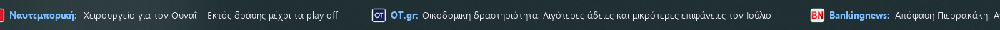<br/><br/>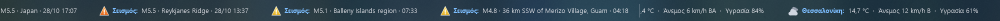</p>

### Λειτουργίες

| Τι | Περιγραφή |
|---|---|
| 📰 Ειδήσεις | RSS από πολλές πηγές σε **6 κατηγορίες** (Οικονομία, Αγορές, Διεθνή, Ελλάδα, Άμυνα & Διπλωματία, Αθλητικά) και δικές σας πηγές· η ίδια είδηση από πολλές πηγές εμφανίζεται μία φορά· έκτακτες με κόκκινη μπάρα, ήχο και σύνδεσμο σε ζωντανό βίντεο· «για αργότερα» με Ctrl+κλικ |
| 📈 Τιμές | Μετοχές Euronext (Αθήνα με 15′ καθυστέρηση, Παρίσι, Άμστερνταμ, Βρυξέλλες, Λισσαβώνα, Μιλάνο, Όσλο), μέταλλα, πετρέλαιο/αέριο, ισοτιμίες ΕΚΤ· ειδοποιήσεις ορίων· οι τιμές επισημαίνονται ως καθυστερημένες |
| 💼 Χαρτοφυλάκιο και ανάλυση | Αξία και κέρδος/ζημιά, RSI, SMA20/50, MACD, κεριά, δοκιμή στρατηγικής, δείκτης φόβου και απληστίας, διάθεση ειδήσεων |
| ⛅ Καιρός | Πόλεις της Ελλάδας: εικονίδιο, θερμοκρασία, άνεμος, υγρασία· χάρτης με κλικ· προειδοποιήσεις έντονων φαινομένων |
| 🌋 Φυσικές καταστροφές | Σεισμοί, πυρκαγιές, πλημμύρες, καταιγίδες, ηφαίστεια ως περιεχόμενο μπάρας· φίλτρα περιοχής, μεγέθους, ηλικίας και ειδών· συγχώνευση αναφορών πολλών οργανισμών |
| 🖥 Μπάρες | Πάνω από τη γραμμή εργασιών ή **μέσα** σε αυτήν (ακολουθεί και την αυτόματη απόκρυψη)· δεύτερη μπάρα, μπάρα ανά οθόνη, μπάρα επιφάνειας που αντικαθιστά την κρυμμένη μπάρα εργασιών· κάθε μπάρα δείχνει ειδήσεις, αγορές ή καιρό |
| 🎨 Εμφάνιση | Θέματα (ίδια με το Opsis), χρώμα, διαφάνεια, υλικό φόντου (acrylic/blur), σβήσιμο στα άκρα· πλήρης πλοήγηση με πληκτρολόγιο |
| 🧩 Plugin ή αυτόνομη | Ενσωματωμένη στο Opsis (δική της σελίδα, γλώσσα και χρώματα του Opsis) ή ξεχωριστή εφαρμογή με εικονίδιο στην περιοχή ειδοποιήσεων |
| 🌍 14 γλώσσες | Ελληνικά, English, Deutsch, Français, Español, Italiano, Português, Русский, Türkçe, 日本語, 한국어, 简体中文, العربية (δεξιά-προς-αριστερά), हिन्दी |

**Νέο στην 0.16.1:** σελίδα «Ροή καταστροφών», ξεχωριστή ταχύτητα ανά μπάρα και ανά μισό split, κατάλογος Yahoo με 100+ προϊόντα προς επιλογή, ενιαία πλάτη καρτών σε όλες τις γλώσσες.

**Νέο στην 0.16.0:** **φυσικές καταστροφές** (σεισμοί, πυρκαγιές, πλημμύρες, καταιγίδες, ηφαίστεια από USGS, EMSC, GDACS, NASA EONET· ο ίδιος σεισμός από πολλούς οργανισμούς δείχνει μέσο όρο μεγέθους και εύρος), **καιρός για οποιονδήποτε τόπο** (όνομα, ταχυδρομικός κώδικας ή συντεταγμένες), το κινούμενο εικονίδιο δείχνει τον τρέχοντα καιρό και την υψηλότερη ενεργή ειδοποίηση, ροδέλα ποντικιού, πετρέλαιο/αέριο από συμβόλαια Yahoo (προαιρετικά).

**Νέο στην 0.15.0:** οδηγός καλωσορίσματος και παράθυρο «Η οικογένεια Opsis» με κινούμενο εικονίδιο (εφημερίδα, μπάλα, ασπίδα, οικονομία, καιρός, φυσικές καταστροφές), ειδοποίηση νέας έκδοσης μία φορά ανά έκδοση, ορθογώνιο εικονίδιο, θέματα Opsis, σωστή ανίχνευση της μπάρας εργασιών με αυτόματη απόκρυψη, πλήρης υποστήριξη πληκτρολογίου στα στοιχεία ελέγχου. Όλο το ιστορικό: [`CHANGELOG.md`](CHANGELOG.md).

### Στιγμιότυπα οθόνης

Σκούρο και φωτεινό θέμα (όλα: [`docs/screenshots`](docs/screenshots)).

<table>
<tr>
<td>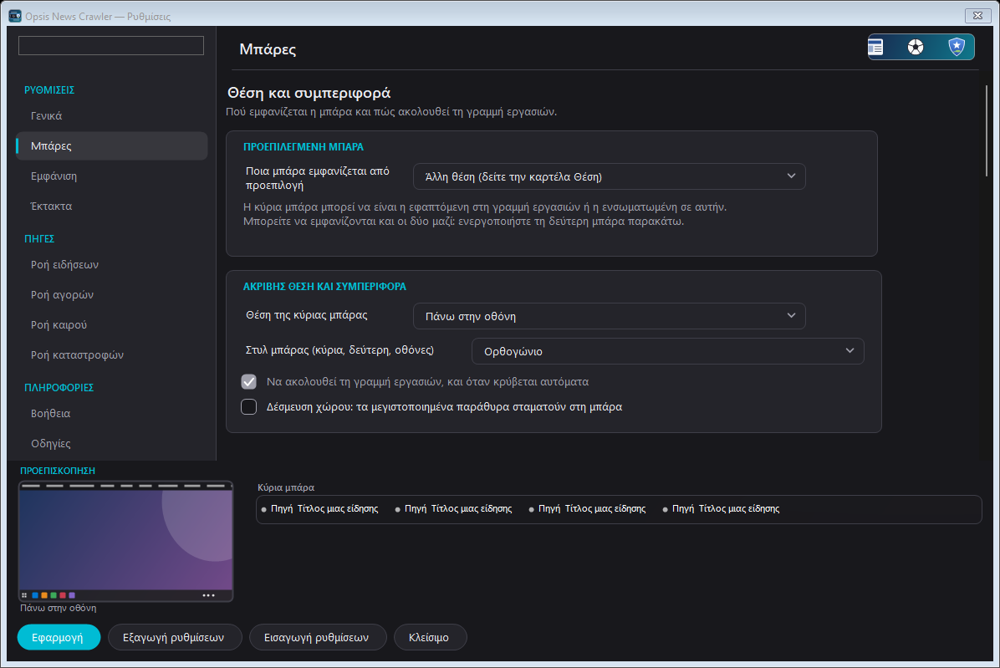<br/><sub>Μπάρες (σκούρο)</sub></td>
<td>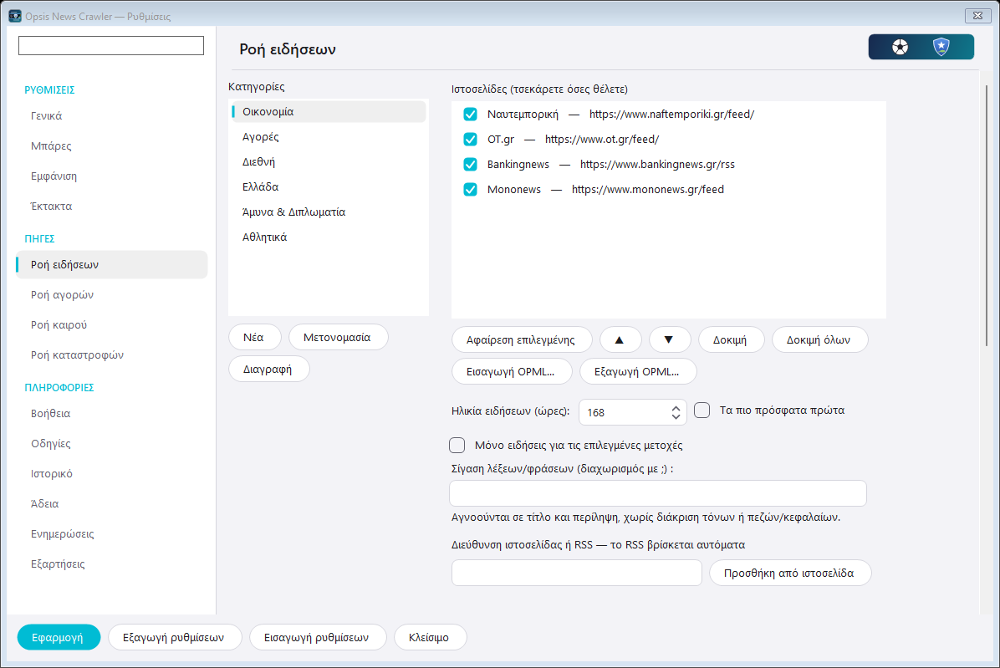<br/><sub>Ροή ειδήσεων (φωτεινό)</sub></td>
</tr>
<tr>
<td>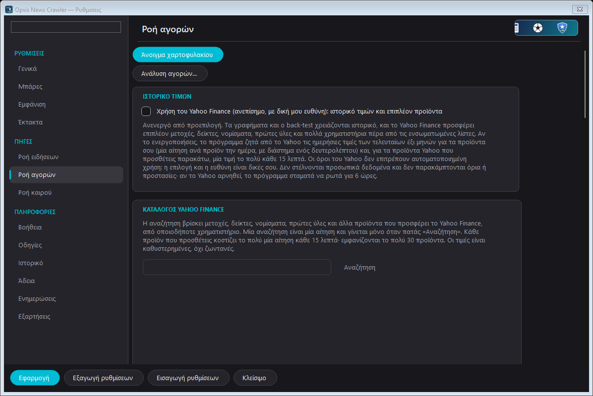<br/><sub>Αγορές</sub></td>
<td>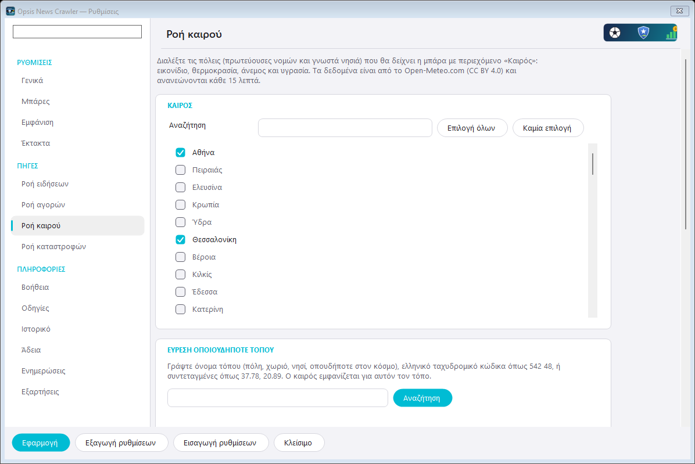<br/><sub>Καιρός</sub></td>
</tr>
<tr>
<td>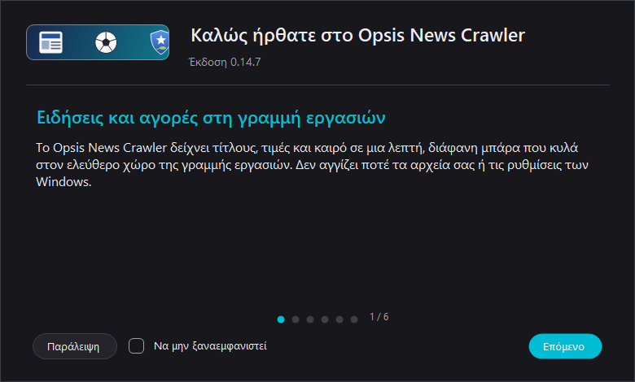<br/><sub>Οδηγός καλωσορίσματος</sub></td>
<td>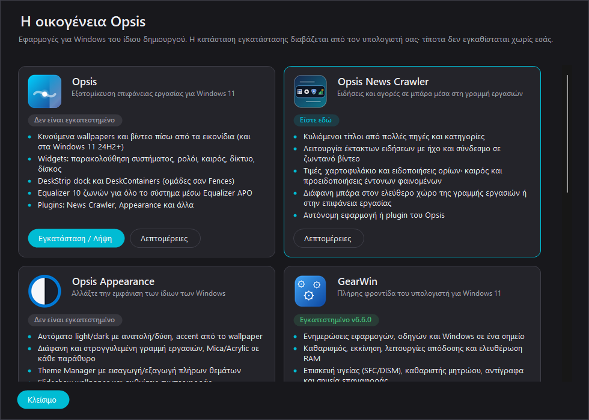<br/><sub>Η οικογένεια Opsis</sub></td>
</tr>
<tr>
<td>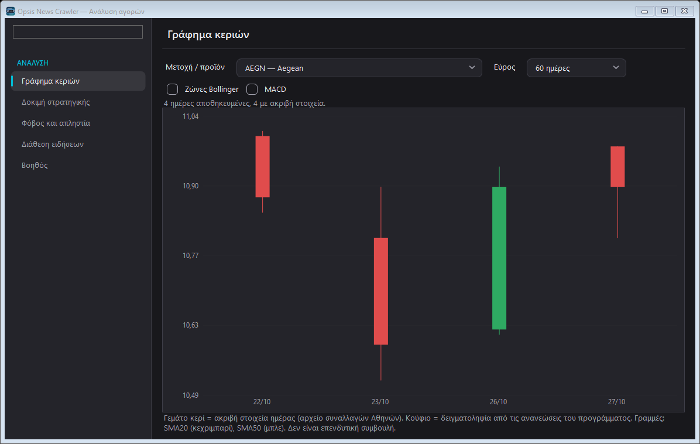<br/><sub>Ανάλυση αγορών</sub></td>
<td>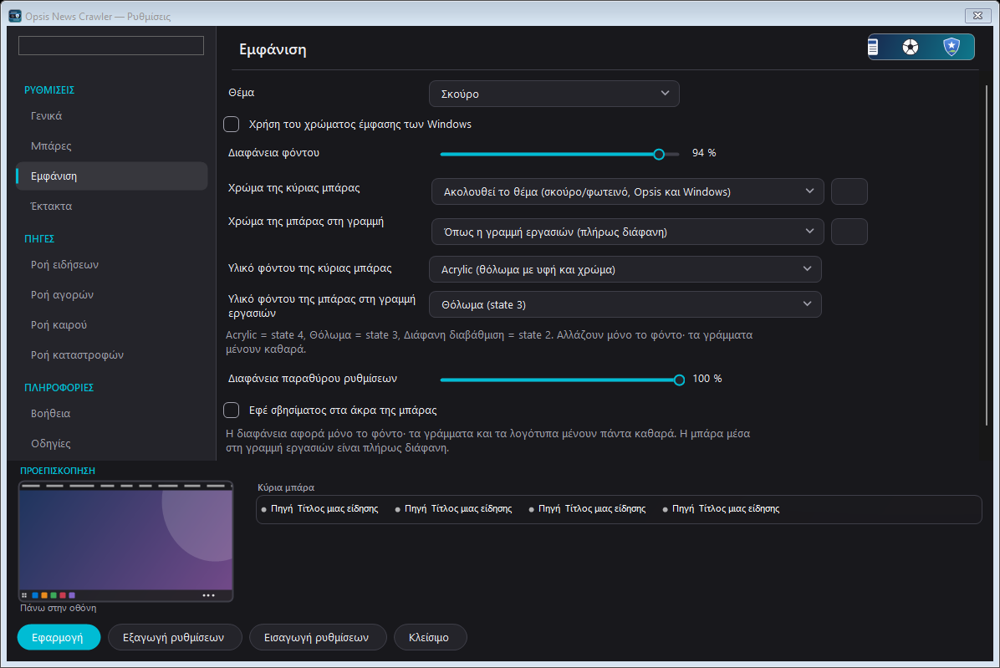<br/><sub>Εμφάνιση</sub></td>
</tr>
<tr>
<td>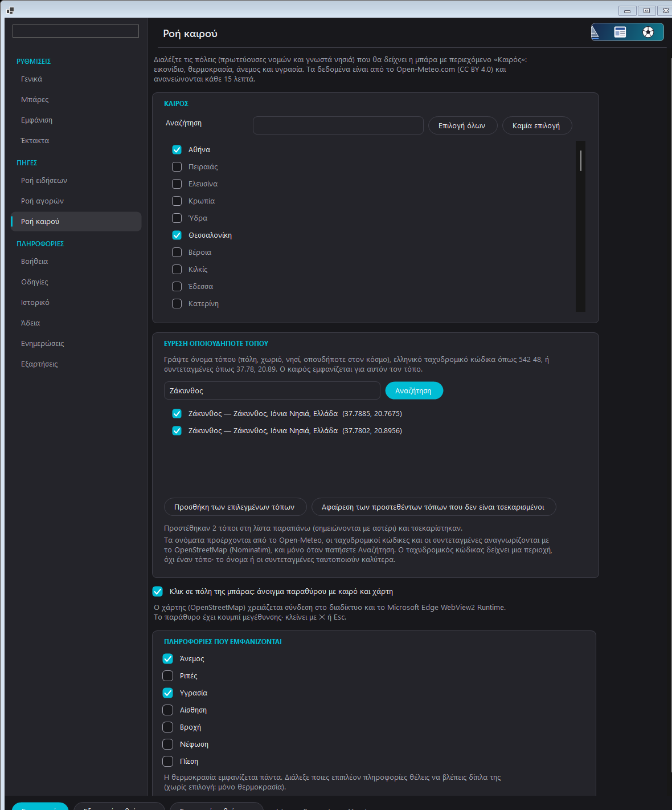<br/><sub>Καιρός: εύρεση οποιουδήποτε τόπου</sub></td>
<td>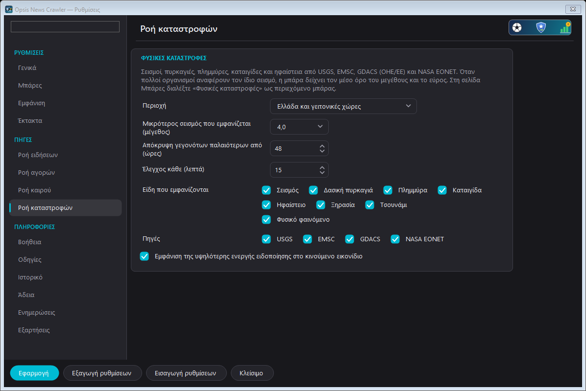<br/><sub>Ροή καταστροφών</sub></td>
</tr>
</table>

### Εγκατάσταση

**Απαιτήσεις:** Windows 11 (64-bit· τα Windows 10 δεν έχουν δοκιμαστεί), [.NET 10 Desktop Runtime](https://dotnet.microsoft.com/download/dotnet/10.0) (ο installer το προτείνει και το κατεβάζει μόνο αν το επιτρέψετε), προαιρετικά WebView2 Runtime (ζωντανό βίντεο έκτακτων).

1. Κατεβάστε από τα [Releases](../../releases/latest) το `OpsisNewsCrawler-Setup.exe` (ή το `…-portable.zip`) και το αντίστοιχο `.sha256`.
2. **Ελέγξτε το αρχείο** (PowerShell, στον φάκελο λήψεων):

   ```powershell
   (Get-FileHash .\OpsisNewsCrawler-Setup.exe -Algorithm SHA256).Hash.ToLower()
   Get-Content .\OpsisNewsCrawler-Setup.exe.sha256
   ```
   Οι δύο γραμμές πρέπει να ξεκινούν με το ίδιο 64ψήφιο αποτέλεσμα. Αν διαφέρουν, μην τρέξετε το αρχείο.
3. Τρέξτε τον installer (δεν χρειάζονται δικαιώματα διαχειριστή). Ο οδηγός ρωτά για τρόπο εγκατάστασης (plugin του Opsis ή ξεχωριστή εφαρμογή), προεπιλεγμένη μπάρα και εξαρτήσεις.

Φορητή έκδοση (`…-portable.zip`): αποσυμπιέστε και τρέξτε `OpsisNewsCrawler.exe` (χωρίς plugin του Opsis· οι ρυθμίσεις μένουν στο `%AppData%\OpsisNewsCrawler`).

Σιωπηλή εγκατάσταση: `OpsisNewsCrawler-Setup.exe /VERYSILENT /SUPPRESSMSGBOXES /NORESTART /MODE=separate|integrated /BAR=above|taskbar /DEPS=all|dotnet|webview2|none` (το `/DEPS` είναι `none` αν δεν δοθεί).

> Οι installers δεν είναι ψηφιακά υπογεγραμμένοι· τα Windows SmartScreen μπορεί να προειδοποιήσουν. Γι' αυτό υπάρχει το SHA-256.

### Απόρρητο και δίκτυο

Το πρόγραμμα δεν στέλνει τηλεμετρία. Εκτός από τις πηγές ειδήσεων/τιμών/καιρού που επιλέγετε, κάνει μόνο: (1) έναν έλεγχο νέας έκδοσης προς το GitHub (`api.github.com`, 30 s μετά την εκκίνηση και μία φορά την ημέρα, με ETag) και (2) όταν χρησιμοποιείτε φυσικές καταστροφές (USGS, EMSC, GDACS, NASA EONET: ένα GET ανά πηγή κάθε 15 λεπτά, μόνο όσο εμφανίζονται ή τροφοδοτούν το εικονίδιο), (3) όταν πατήσετε Αναζήτηση τόπου (Open-Meteo geocoding· OpenStreetMap Nominatim για ταχυδρομικούς κώδικες και συντεταγμένες, το πολύ ένα αίτημα το δευτερόλεπτο) και (4) όταν ανοίξετε το παράθυρο «Η οικογένεια Opsis», τη λήψη του καταλόγου εφαρμογών (`raw.githubusercontent.com`, το πολύ μία φορά την ημέρα) και την ερώτηση για την τελευταία έκδοση κάθε εγκατεστημένης εφαρμογής του καταλόγου. Κανένα αρχείο δεν κατεβαίνει χωρίς τη δική σας επιβεβαίωση και κανένα δεν εκτελείται από το πρόγραμμα. Το κλειδί Anthropic του προαιρετικού βοηθού αποθηκεύεται κρυπτογραφημένο (DPAPI) και δεν εξάγεται.

### Πηγές δεδομένων, πιστώσεις και άδειες τρίτων

Ειδήσεις: RSS των ίδιων των εκδοτών (μόνο τίτλος, σύντομη περίληψη και σύνδεσμος). Τιμές: Euronext, gold-api.com, Frankfurter/ΕΚΤ, FRED/EIA. Καιρός: [Open-Meteo.com](https://open-meteo.com) (CC BY 4.0). Σεισμοί και καταστροφές: [USGS](https://earthquake.usgs.gov), [EMSC](https://www.emsc-csem.org), [GDACS](https://www.gdacs.org), [NASA EONET](https://eonet.gsfc.nasa.gov). Χάρτης και αναζήτηση τόπων: © συνεργάτες του [OpenStreetMap](https://www.openstreetmap.org/copyright) (ODbL). Οι τιμές δεν αποτελούν επενδυτική συμβουλή. Λεπτομέρειες και όροι: [`docs/DATA-SOURCES.md`](docs/DATA-SOURCES.md).

Βιβλιοθήκες: [Microsoft.Web.WebView2](https://www.nuget.org/packages/Microsoft.Web.WebView2) (Microsoft, άδεια BSD-style της Microsoft), για τα tests xUnit (Apache-2.0). Οι ιδέες του χαρτοφυλακίου προέρχονται από το [stonks-cli](https://github.com/igoropaniuk/stonks-cli) (MIT) και του RSI/SMA από το [greek-stocks-ai](https://github.com/karidasd/greek-stocks-ai)· ο κώδικας γράφτηκε από την αρχή. Ο installer χρησιμοποιεί το [Inno Setup](https://jrsoftware.org/isinfo.php).

### Χτίσιμο από τον πηγαίο κώδικα

```
dotnet build OpsisNewsCrawler.sln -c Release
dotnet test  OpsisNewsCrawler.sln -c Release
powershell -ExecutionPolicy Bypass -File tools\release.ps1     # publish + installer + portable + SHA-256 στο release\<έκδοση>-assets
```

Χρειάζεται .NET 10 SDK και Inno Setup 6/7. Δομή: `src/OpsisNewsCrawler.Core` (μοντέλα, ρυθμίσεις, RSS, τιμές, καιρός, γλώσσες), `src/OpsisNewsCrawler.Windows` (WinForms UI, Win32), `src/OpsisNewsCrawler.App` (αυτόνομη εφαρμογή), `src/OpsisNewsCrawler.OpsisPlugin` + `…Plugin.Abstractions` (plugin του Opsis), `tests/` (xUnit), `installer/`, `tools/`, `docs/`.

---

## English

A scrolling news, market-price and weather bar for the Windows desktop — above the taskbar, **inside** it, or in the middle of the screen. It runs on its own (notification-area icon) or as a plugin of **Opsis - Desktop Customization**. Free and open source (MIT).

<p align="center"><br/><br/></p>

### Features

| What | Description |
|---|---|
| 📰 News | RSS from many sources in **6 categories** (Economy, Markets, International, Greece, Defence & Diplomacy, Sports) plus your own; the same story from several sources is shown once; breaking news with a red bar, sound and a live-video link; "read later" with Ctrl+click |
| 📈 Prices | Euronext shares (Athens 15′ delayed, Paris, Amsterdam, Brussels, Lisbon, Milan, Oslo), metals, oil/gas, ECB currency rates; price alerts; quotes are labelled delayed |
| 💼 Portfolio and analysis | Value and profit/loss, RSI, SMA20/50, MACD, candlesticks, strategy back-test, fear & greed gauge, news mood |
| ⛅ Weather | Greek cities: icon, temperature, wind, humidity; map on click; severe-weather warnings |
| 🌋 Natural disasters | Earthquakes, fires, floods, storms, volcanoes as bar content; filters for region, magnitude, age and kind; reports of several organisations merged |
| 🖥 Bars | Above the taskbar or **inside** it (follows auto-hide); a second bar, a bar per monitor, a desktop bar that stands in for a hidden taskbar; each bar shows news, markets or weather |
| 🎨 Look | Themes (the same as Opsis), colour, transparency, background material (acrylic/blur), fading ends; fully keyboard-operable controls |
| 🧩 Plugin or stand-alone | Integrated into Opsis (its own page, Opsis language and colours) or a separate app with a notification-area icon |
| 🌍 14 languages | Greek, English, German, French, Spanish, Italian, Portuguese, Russian, Turkish, Japanese, Korean, Simplified Chinese, Arabic (right-to-left), Hindi |

**New in 0.16.1:** "Disasters flow" page, a separate speed per bar and per half of a split bar, a Yahoo catalogue with 100+ instruments to pick from, the same card width in every language.

**New in 0.16.0:** **natural disasters** (earthquakes, fires, floods, storms, volcanoes from USGS, EMSC, GDACS, NASA EONET; the same earthquake from several organisations shows the average magnitude and the range), **weather for any place** (name, postcode or coordinates), the animated icon shows the current weather and the highest active alert, mouse wheel, oil and gas from Yahoo futures (optional).

**New in 0.15.0:** welcome guide and "The Opsis family" window with the animated icon (newspaper, ball, shield, economy, weather, natural disasters), one update notice per version, rectangular icon, Opsis themes, correct auto-hide taskbar detection, full keyboard support in the custom controls. Full history: [`CHANGELOG.md`](CHANGELOG.md).

### Screenshots

Dark and light themes (all of them: [`docs/screenshots`](docs/screenshots)).

<table>
<tr>
<td>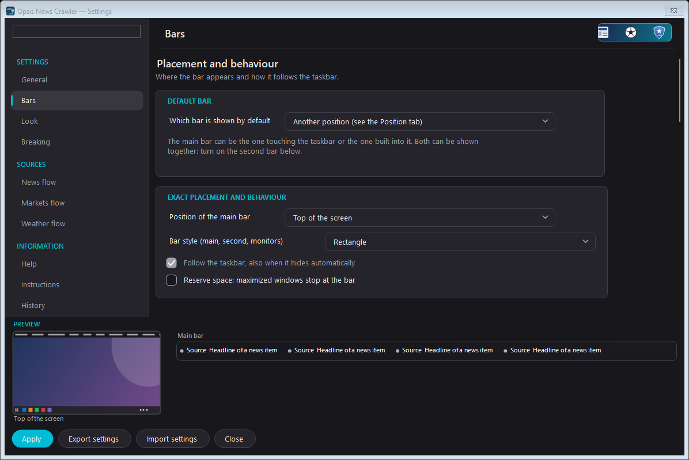<br/><sub>Bars (dark)</sub></td>
<td>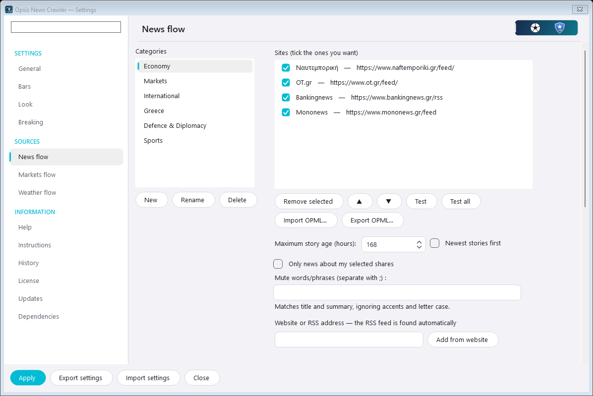<br/><sub>News flow (light)</sub></td>
</tr>
<tr>
<td>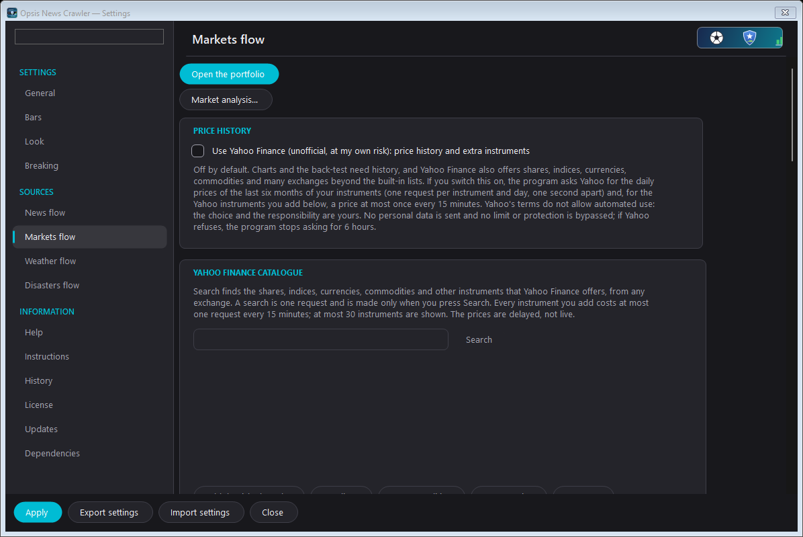<br/><sub>Markets</sub></td>
<td>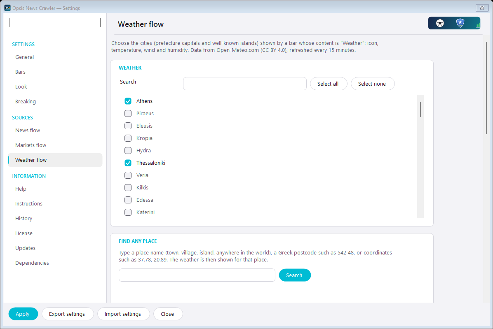<br/><sub>Weather</sub></td>
</tr>
<tr>
<td>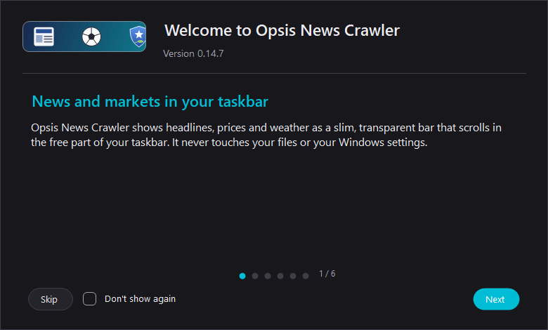<br/><sub>Welcome guide</sub></td>
<td>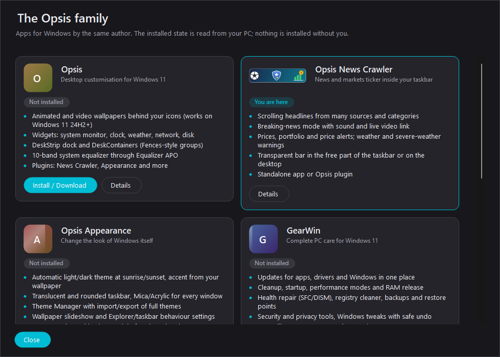<br/><sub>The Opsis family</sub></td>
</tr>
<tr>
<td>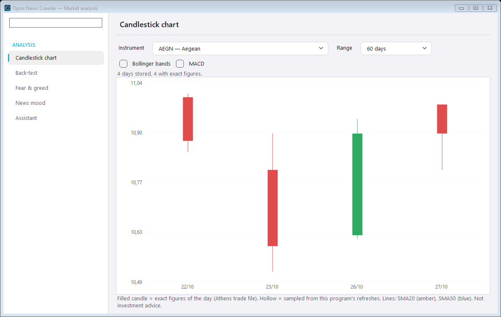<br/><sub>Market analysis</sub></td>
<td>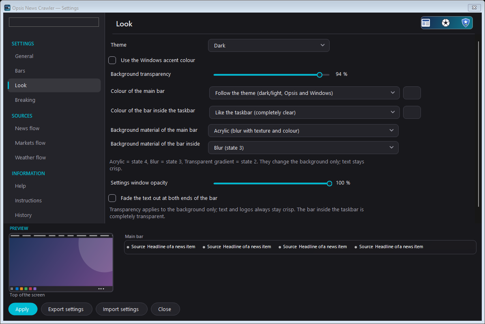<br/><sub>Look</sub></td>
</tr>
<tr>
<td>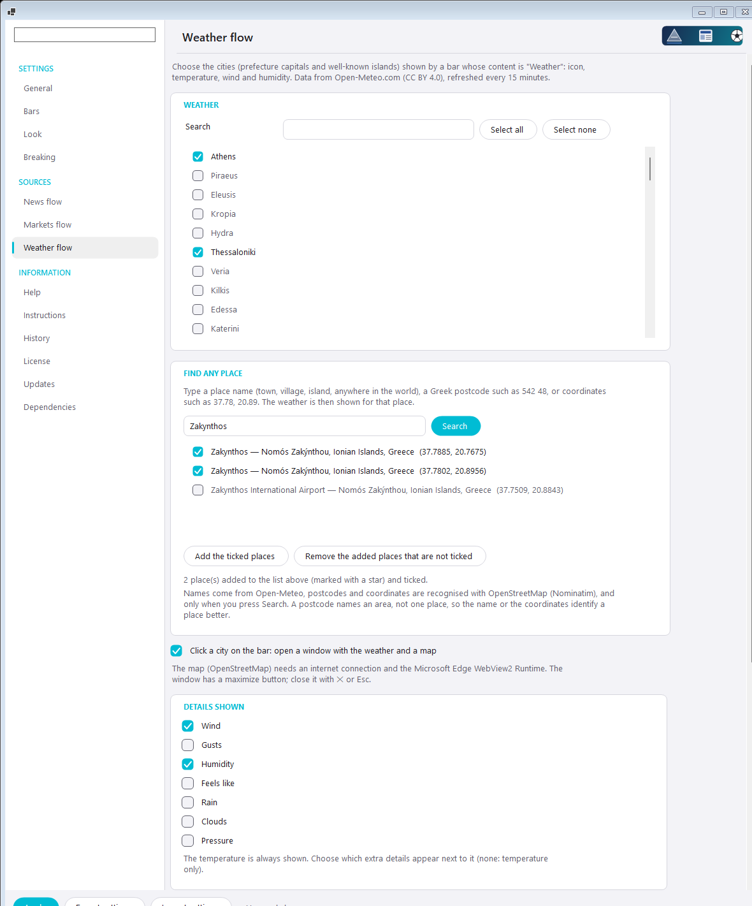<br/><sub>Weather: find any place</sub></td>
<td>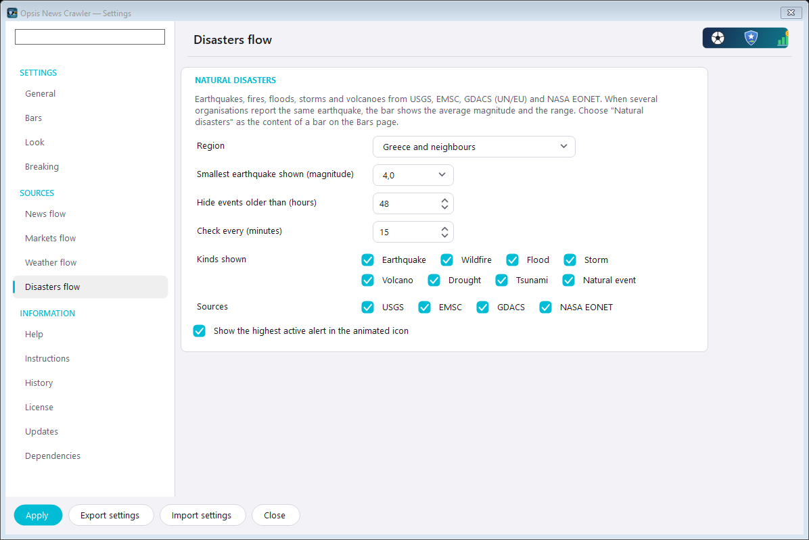<br/><sub>Disasters flow</sub></td>
</tr>
</table>

### Installation

**Requirements:** Windows 11 (64-bit; Windows 10 is untested), the [.NET 10 Desktop Runtime](https://dotnet.microsoft.com/download/dotnet/10.0) (the installer offers it and downloads it only if you allow), optionally the WebView2 Runtime (live video of breaking news).

1. Download `OpsisNewsCrawler-Setup.exe` (or `…-portable.zip`) and the matching `.sha256` from [Releases](../../releases/latest).
2. **Verify the file** (PowerShell, in the download folder):

   ```powershell
   (Get-FileHash .\OpsisNewsCrawler-Setup.exe -Algorithm SHA256).Hash.ToLower()
   Get-Content .\OpsisNewsCrawler-Setup.exe.sha256
   ```
   Both lines must start with the same 64-digit value. If they differ, do not run the file.
3. Run the installer (no administrator rights needed). The wizard asks how to install (Opsis plugin or separate app), the default bar and the dependencies.

Portable (`…-portable.zip`): unzip and run `OpsisNewsCrawler.exe` (no Opsis plugin; settings stay in `%AppData%\OpsisNewsCrawler`).

Silent install: `OpsisNewsCrawler-Setup.exe /VERYSILENT /SUPPRESSMSGBOXES /NORESTART /MODE=separate|integrated /BAR=above|taskbar /DEPS=all|dotnet|webview2|none` (`/DEPS` defaults to `none`).

> The installers are not code-signed; Windows SmartScreen may warn. That is what the SHA-256 is for.

### Privacy and network

The program sends no telemetry. Besides the news/price/weather sources you choose, it only does: (1) one version check to GitHub (`api.github.com`, 30 s after the start and once a day, with an ETag) and (2) when natural disasters are used (USGS, EMSC, GDACS, NASA EONET: one GET per source every 15 minutes, only while a bar shows them or the icon uses them), (3) when you press Search for a place (Open-Meteo geocoding; OpenStreetMap Nominatim for postcodes and coordinates, at most one request a second) and (4) when you open "The Opsis family" window, one download of the app catalogue (`raw.githubusercontent.com`, at most once a day) and one question about the latest release of each installed app of the catalogue. No file is downloaded without your confirmation and the program never runs one. The Anthropic key of the optional assistant is stored encrypted (DPAPI) and never exported.

### Data sources, credits and third-party licences

News: the publishers' own RSS feeds (only the title, a short summary and the link). Prices: Euronext, gold-api.com, Frankfurter/ECB, FRED/EIA. Weather: [Open-Meteo.com](https://open-meteo.com) (CC BY 4.0). Earthquakes and disasters: [USGS](https://earthquake.usgs.gov), [EMSC](https://www.emsc-csem.org), [GDACS](https://www.gdacs.org), [NASA EONET](https://eonet.gsfc.nasa.gov). Map and place search: © [OpenStreetMap](https://www.openstreetmap.org/copyright) contributors (ODbL). Prices are not investment advice. Details and terms: [`docs/DATA-SOURCES.md`](docs/DATA-SOURCES.md).

Libraries: [Microsoft.Web.WebView2](https://www.nuget.org/packages/Microsoft.Web.WebView2) (Microsoft licence), xUnit for the tests (Apache-2.0). The portfolio idea comes from [stonks-cli](https://github.com/igoropaniuk/stonks-cli) (MIT) and the RSI/SMA idea from [greek-stocks-ai](https://github.com/karidasd/greek-stocks-ai); the code was written from scratch. The installer is built with [Inno Setup](https://jrsoftware.org/isinfo.php).

### Building from source

```
dotnet build OpsisNewsCrawler.sln -c Release
dotnet test  OpsisNewsCrawler.sln -c Release
powershell -ExecutionPolicy Bypass -File tools\release.ps1     # publish + installer + portable + SHA-256 into release\<version>-assets
```

Needs the .NET 10 SDK and Inno Setup 6/7. Layout: `src/OpsisNewsCrawler.Core` (models, settings, RSS, prices, weather, languages), `src/OpsisNewsCrawler.Windows` (WinForms UI, Win32), `src/OpsisNewsCrawler.App` (stand-alone app), `src/OpsisNewsCrawler.OpsisPlugin` + `…Plugin.Abstractions` (Opsis plugin), `tests/` (xUnit), `installer/`, `tools/`, `docs/`.

---

## Η οικογένεια Opsis / The Opsis family

Ο ίδιος δημιουργός, εφαρμογές για Windows / apps for Windows by the same author (το παράθυρο «Η οικογένεια Opsis» μέσα στην εφαρμογή δείχνει ποιες είναι εγκατεστημένες / the "Opsis family" window inside the app shows which are installed):

| App | |
|---|---|
| [Opsis](https://github.com/giorstergiopoulos-design/Opsis) | Desktop customisation for Windows 11 — wallpapers, widgets, DeskStrip, plugins / Εξατομίκευση επιφάνειας εργασίας |
| [Opsis News Crawler](https://github.com/giorstergiopoulos-design/OpsisNewsCrawler) | News and markets ticker inside your taskbar (**this repository**) |
| [Opsis Appearance](https://github.com/giorstergiopoulos-design/OpsisAppearance) | Change the look of Windows itself |
| [GearWin](https://github.com/giorstergiopoulos-design/GearWin) | Complete PC care for Windows 11 |
| [Opsis Media Player Pro](https://github.com/giorstergiopoulos-design/OpsisMediaPlayerPro) | Fast video and audio player on the VLC engine |
| [Kombos](https://github.com/giorstergiopoulos-design/Kombos) | A local hub for AI tools, with Claude as the agent |
| [Waveframe](https://github.com/giorstergiopoulos-design/waveframe) | Real-time audio enhancer and player |

## Άδεια / License

[MIT](LICENSE) © 2026 giorstergiopoulos-design
