# Opsis News Crawler

Μια μπάρα ειδήσεων, τιμών αγορών και καιρού που κυλά στην επιφάνεια εργασίας των Windows — πάνω από τη
γραμμή εργασιών, μέσα σε αυτήν, ή στο κέντρο της οθόνης. Τρέχει μόνη της (εικονίδιο στην περιοχή
ειδοποιήσεων) ή ως plugin του **Opsis - Desktop Customization**. Δωρεάν και ανοιχτού κώδικα (MIT).

*A scrolling news, market-price and weather bar for the Windows desktop — above the taskbar, inside it or in the middle of the screen. Runs on its own (notification-area icon) or as a plugin of **Opsis - Desktop Customization**. Free and open source (MIT). See the [English section](#english) below.*

<p align="center">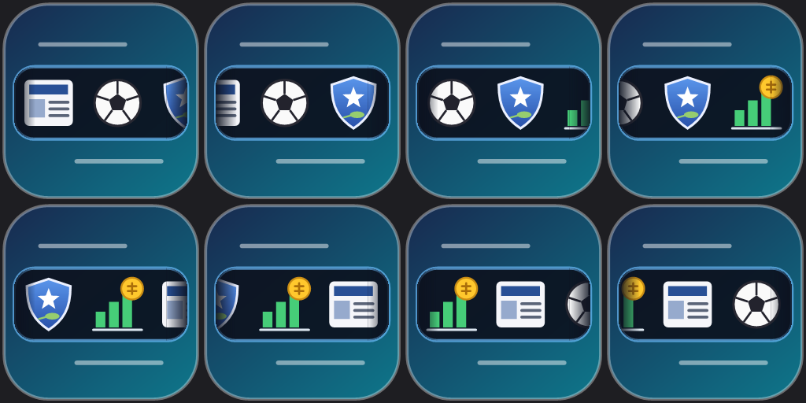</p>

## Περιεχόμενα / Contents

- [Ελληνικά](#ελληνικά)
- [English](#english)
- [Άδεια / License](#άδεια--license)

## Ελληνικά

### Λειτουργίες

| Τι | Περιγραφή |
|---|---|
| 📰 Ειδήσεις | RSS από πολλές πηγές σε **6 κατηγορίες**: Οικονομία, Αγορές, Διεθνή, Ελλάδα, **Άμυνα & Διπλωματία**, **Αθλητικά** (και δικές σου κατηγορίες)· έκτακτες ειδήσεις με κόκκινη μπάρα, ήχο και ζωντανή προεπισκόπηση βίντεο· φίλτρα λέξεων, ηλικίας, εισαγωγή/εξαγωγή OPML |
| 📈 Τιμές | Μετοχές Euronext (Αθήνα με 15′ καθυστέρηση, Παρίσι, Άμστερνταμ, Βρυξέλλες, Λισσαβώνα, Μιλάνο, Όσλο), μέταλλα, πετρέλαιο/αέριο, κρυπτονομίσματα, ισοτιμίες ΕΚΤ· ειδοποιήσεις τιμής |
| 💼 Χαρτοφυλάκιο | Οι μετοχές που έχεις (ποσότητα, μέση τιμή): αξία και κέρδος/ζημιά σε ευρώ με ζωντανές τιμές, RSI και σήμα SMA20/50 |
| ⛅ Καιρός | 71 πόλεις της Ελλάδας: εικονίδιο, θερμοκρασία (1 δεκαδικό), άνεμος, υγρασία· χάρτης με κλικ· προειδοποιήσεις έντονων φαινομένων |
| 🖥 Μπάρες | Πάνω από τη γραμμή εργασιών, **μέσα** στη γραμμή (παίρνει το ύψος της και γλιστρά μαζί με την αυτόματη απόκρυψη), δεύτερη μπάρα, μπάρα ανά οθόνη, μπάρα επιφάνειας εργασίας· κάθε μισό της μπάρας μπορεί να δείχνει ειδήσεις, αγορές ή καιρό |
| 🎨 Εμφάνιση | Χρώμα, διαφάνεια, υλικό φόντου (acrylic/blur), σβήσιμο στα άκρα, θέμα — ίδια με το Opsis |
| 🧩 Plugin | Ενσωματωμένη εγκατάσταση στο Opsis (δική του σελίδα, χρώματα και γλώσσα του Opsis) ή αυτόνομη εφαρμογή |
| 🌍 14 γλώσσες | Ελληνικά, English, Deutsch, Français, Español, Italiano, Português, Русский, Türkçe, 日本語, 한국어, 简体中文, العربية (με δεξιά-προς-αριστερά διάταξη), हिन्दी |

Επίσης: κινούμενο εικονίδιο στην περιοχή ειδοποιήσεων (εφημερίδα, μπάλα, ασπίδα, γράφημα με νομίσματα να περνούν από
δεξιά προς αριστερά), «Για αργότερα» με Ctrl+κλικ, αυτόματος έλεγχος ενημερώσεων (προαιρετικός, με επαλήθευση SHA-256),
σελίδα **Εξαρτήσεων** (.NET 10 Desktop Runtime, WebView2) και στον installer, εξαγωγή/εισαγωγή ρυθμίσεων.

### Στιγμιότυπα οθόνης / Screenshots

<table>
<tr>
<td>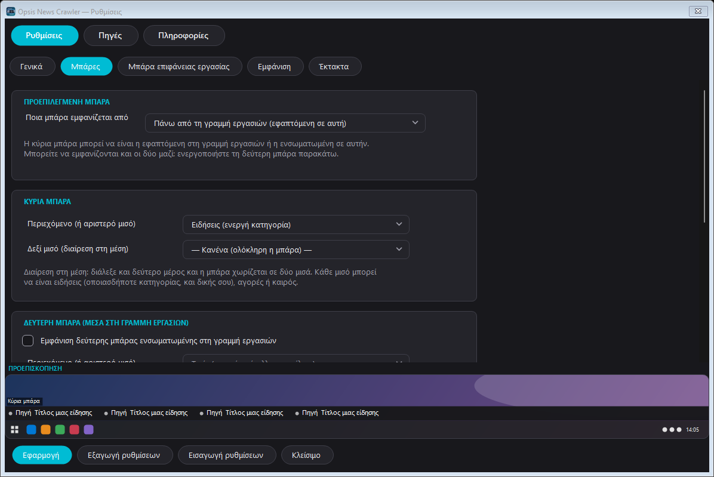<br/><sub>Μπάρες και θέση</sub></td>
<td>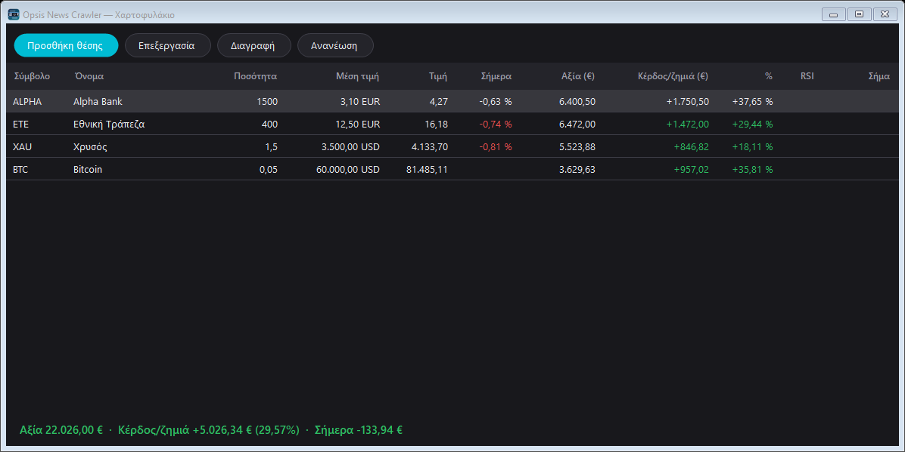<br/><sub>Χαρτοφυλάκιο</sub></td>
</tr>
<tr>
<td>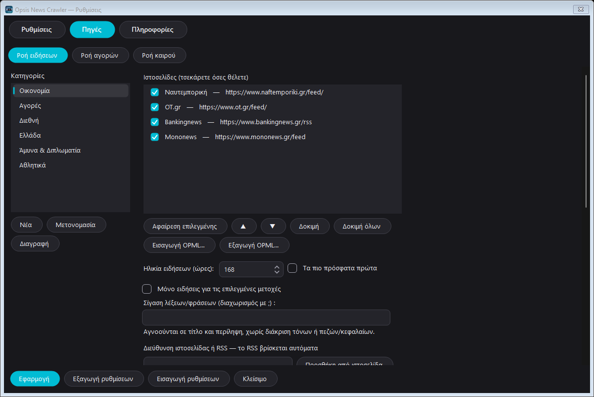<br/><sub>Ειδήσεις: 6 κατηγορίες (και Άμυνα & Διπλωματία, Αθλητικά)</sub></td>
<td>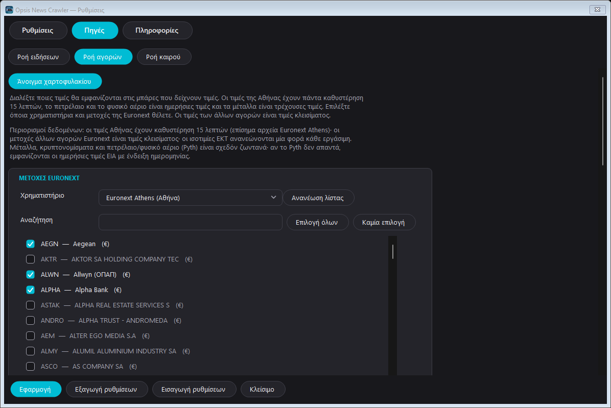<br/><sub>Αγορές</sub></td>
</tr>
<tr>
<td>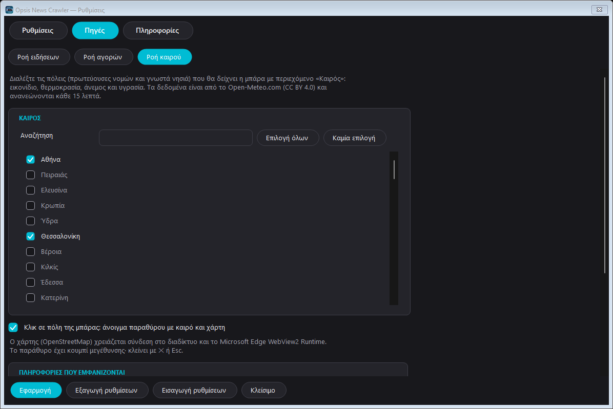<br/><sub>Καιρός</sub></td>
<td>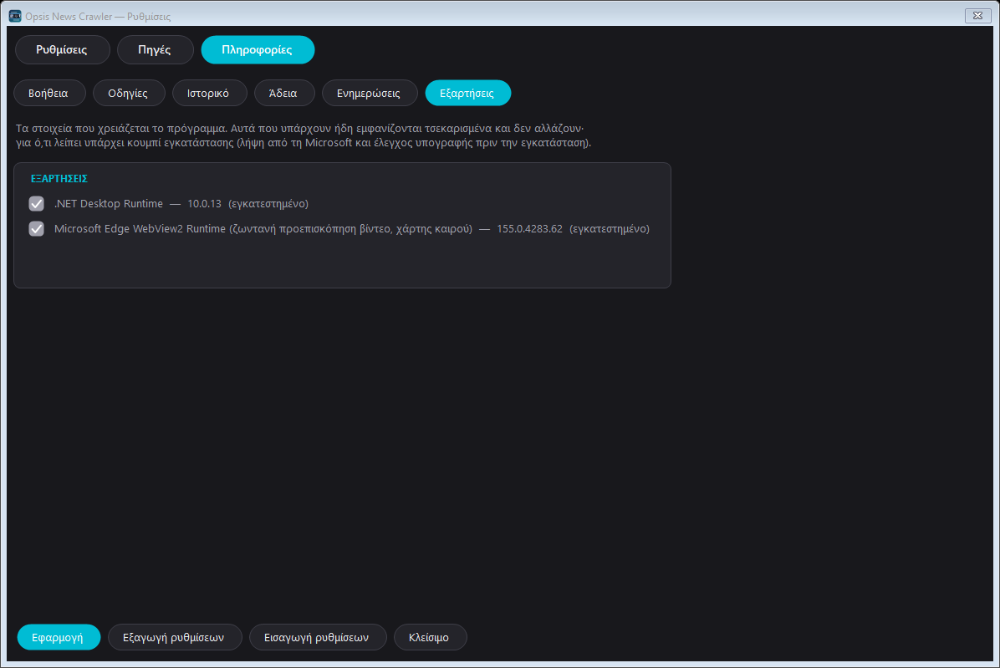<br/><sub>Εξαρτήσεις</sub></td>
</tr>
</table>

Η ίδια η μπάρα:

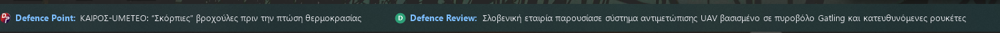<br/>
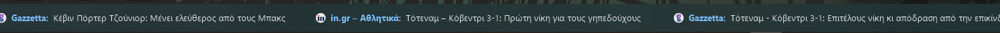<br/>
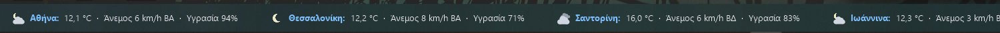<br/>
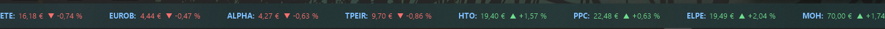

Όλα τα στιγμιότυπα: [`docs/screenshots/el`](docs/screenshots/el) · [`docs/screenshots/en`](docs/screenshots/en).

### Εγκατάσταση

Κατεβάστε το τελευταίο `OpsisNewsCrawler-Setup.exe` από τα [Releases](../../releases) και εκτελέστε το (δεν χρειάζεται
δικαιώματα διαχειριστή). Ο οδηγός ρωτά:

1. **Τρόπο εγκατάστασης**: ενσωματωμένο plugin του Opsis ή ξεχωριστή εφαρμογή.
2. **Προεπιλεγμένη μπάρα**: πάνω από τη γραμμή εργασιών ή μέσα σε αυτήν.
3. **Εξαρτήσεις**: .NET 10 Desktop Runtime και WebView2 Runtime. Όσα υπάρχουν ήδη φαίνονται τσεκαρισμένα και δεν αλλάζουν·
   όσα λείπουν κατεβαίνουν από τη Microsoft και τρέχουν μόνο αν το αρχείο έχει έγκυρη υπογραφή Microsoft.

Σιωπηλή εγκατάσταση: `OpsisNewsCrawler-Setup.exe /VERYSILENT /SUPPRESSMSGBOXES /NORESTART /MODE=separate|integrated /BAR=above|taskbar /DEPS=all|dotnet|webview2|none`
(το `/DEPS` είναι `none` αν δεν δοθεί: μια σιωπηλή εγκατάσταση δεν κατεβάζει τίποτα μόνη της).
Το SHA-256 του installer δημοσιεύεται δίπλα του (`OpsisNewsCrawler-Setup.exe.sha256`).

> Οι installers δεν είναι ψηφιακά υπογεγραμμένοι· τα Windows SmartScreen μπορεί να προειδοποιήσουν.

### Χτίσιμο από τον πηγαίο κώδικα

```
dotnet build OpsisNewsCrawler.sln -c Release
dotnet test  OpsisNewsCrawler.sln -c Release
powershell -ExecutionPolicy Bypass -File tools\release.ps1     # publish + installer (Inno Setup 6) + SHA-256, με ελέγχους
```

Χρειάζεται .NET 10 SDK και Inno Setup 6. Το `tools\release.ps1` αποτυγχάνει αν το plugin που μπαίνει στον installer
έχει διαφορετική έκδοση από την εφαρμογή.

### Δομή αποθετηρίου

- `src/OpsisNewsCrawler.Core/` — μοντέλα, ρυθμίσεις, RSS, τιμές, καιρός, χαρτοφυλάκιο, γλώσσες (`Locales\*.json`)
- `src/OpsisNewsCrawler.Windows/` — όλο το WinForms UI (μπάρες, ρυθμίσεις, χαρτοφυλάκιο, εικονίδιο) και Win32
- `src/OpsisNewsCrawler.App/` — η αυτόνομη εφαρμογή (εικονίδιο στην περιοχή ειδοποιήσεων)
- `src/OpsisNewsCrawler.OpsisPlugin/` — το plugin DLL για το Opsis · `src/OpsisNewsCrawler.Plugin.Abstractions/` — το συμβόλαιο
- `tests/OpsisNewsCrawler.Core.Tests/` — unit tests (xUnit) · `installer/` — κοινά κομμάτια του installer · `tools/` — `release.ps1`
- `docs/` — σημειώσεις έκδοσης, πηγές δεδομένων (`DATA-SOURCES.md`), λίστα εργασιών (`TASKS.md`), στιγμιότυπα

### Πηγές δεδομένων και πιστώσεις

Ειδήσεις: RSS των ίδιων των εκδοτών (εμφανίζονται μόνο τίτλος, σύντομη περίληψη και σύνδεσμος). Τιμές: Euronext, gold-api.com,
Frankfurter/ΕΚΤ, FRED/EIA. Καιρός: [Open-Meteo.com](https://open-meteo.com) (CC BY 4.0). Χάρτης: © συνεργάτες του OpenStreetMap.
Οι ιδέες του χαρτοφυλακίου προέρχονται από το [stonks-cli](https://github.com/igoropaniuk/stonks-cli) (MIT) και του RSI/SMA από
το [greek-stocks-ai](https://github.com/karidasd/greek-stocks-ai)· ο κώδικας γράφτηκε από την αρχή. Οι τιμές δεν αποτελούν
επενδυτική συμβουλή. Λεπτομέρειες και όροι: [`docs/DATA-SOURCES.md`](docs/DATA-SOURCES.md).

## English

### Features

| What | Description |
|---|---|
| 📰 News | RSS from many sources in **6 categories**: Economy, Markets, International, Greece, **Defence & Diplomacy**, **Sports** (plus your own); urgent news with a red bar, sound and live video preview; word/age filters, OPML import/export |
| 📈 Prices | Euronext shares (Athens 15′ delayed, Paris, Amsterdam, Brussels, Lisbon, Milan, Oslo), metals, oil/gas, crypto, ECB currency rates; price alerts |
| 💼 Portfolio | The shares you own (quantity, average price): value and profit/loss in euro with live prices, RSI and an SMA20/50 signal |
| ⛅ Weather | 71 Greek cities: icon, temperature (one decimal), wind, humidity; map on click; severe-weather warnings |
| 🖥 Bars | Above the taskbar, **inside** the taskbar (takes its height and slides with auto-hide), a second bar, a bar per monitor, a desktop bar; each half of a bar can show news, markets or weather |
| 🎨 Look | Colour, transparency, background material (acrylic/blur), fading ends, theme — the same as Opsis |
| 🧩 Plugin | Integrated into Opsis (its own page, Opsis colours and language) or a stand-alone app |
| 🌍 14 languages | Greek, English, German, French, Spanish, Italian, Portuguese, Russian, Turkish, Japanese, Korean, Simplified Chinese, Arabic (with right-to-left layout), Hindi |

Also: an animated notification-area icon (newspaper, ball, shield, chart with coins passing from right to left), "Read later"
with Ctrl+click, an optional update check (SHA-256 verified), a **Dependencies** page (.NET 10 Desktop Runtime, WebView2) in the
settings and in the installer, settings export/import.

### Screenshots

<table>
<tr>
<td>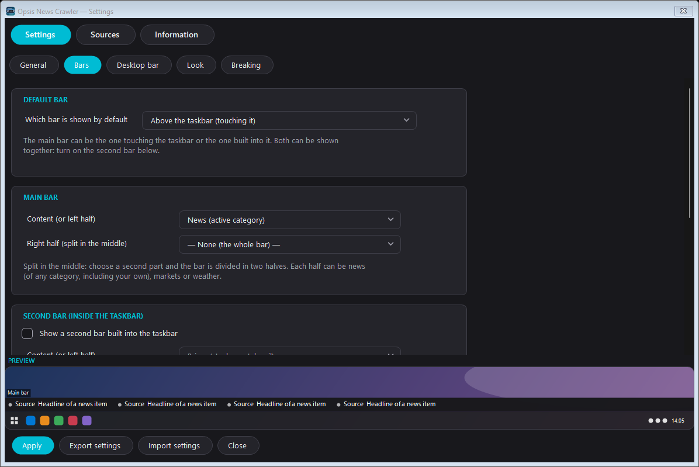<br/><sub>Bars and position</sub></td>
<td>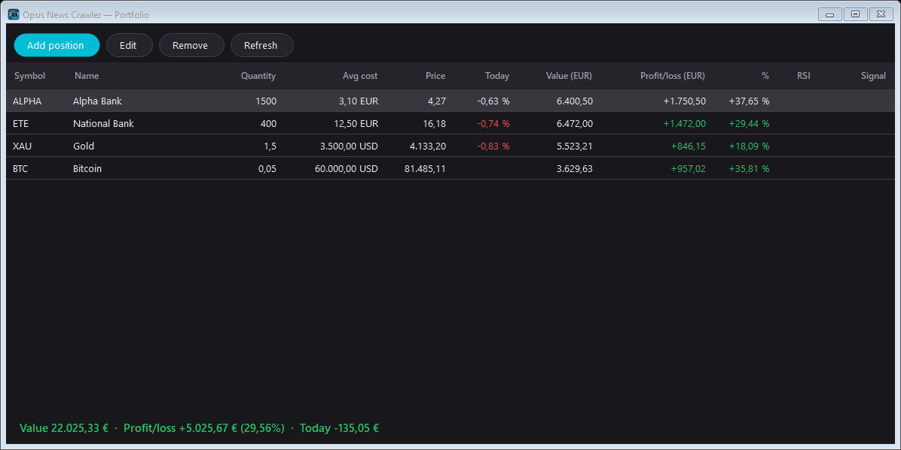<br/><sub>Portfolio</sub></td>
</tr>
<tr>
<td>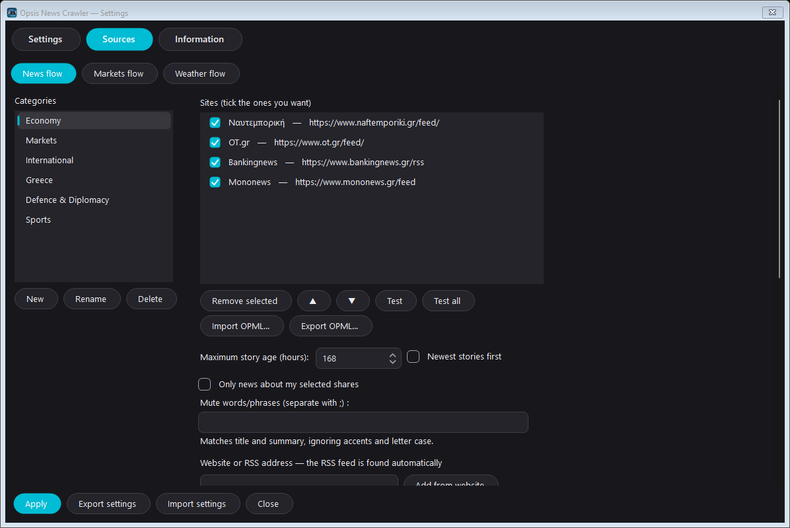<br/><sub>News: 6 categories (incl. Defence & Diplomacy, Sports)</sub></td>
<td>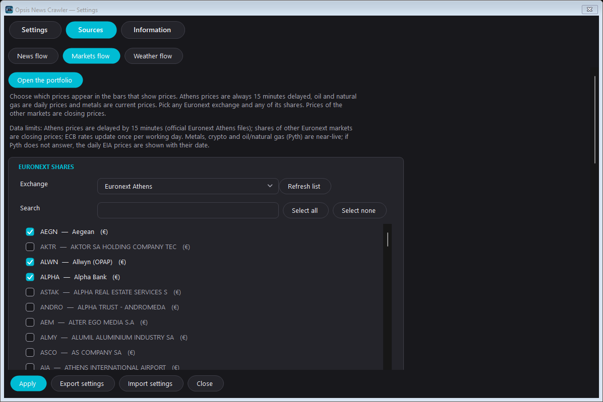<br/><sub>Markets</sub></td>
</tr>
<tr>
<td>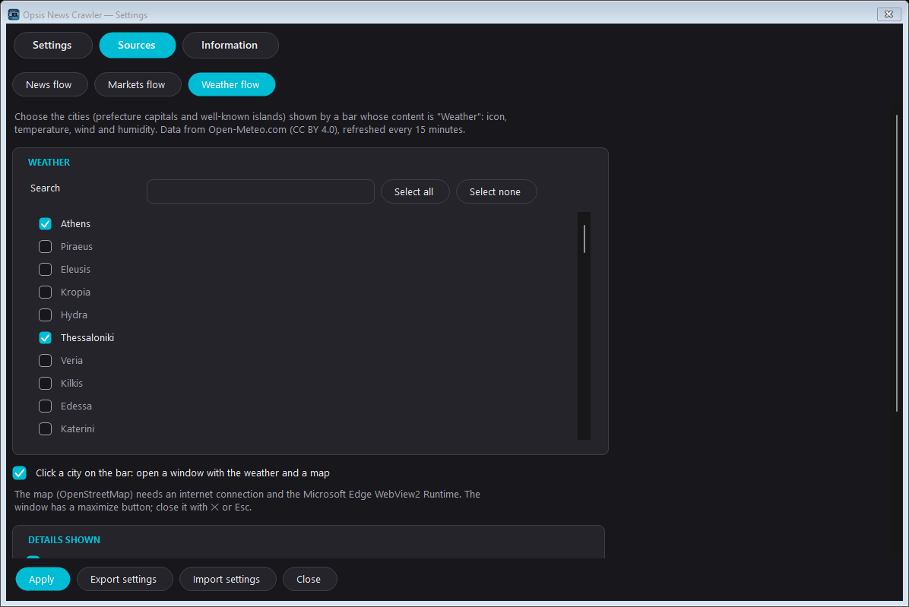<br/><sub>Weather</sub></td>
<td>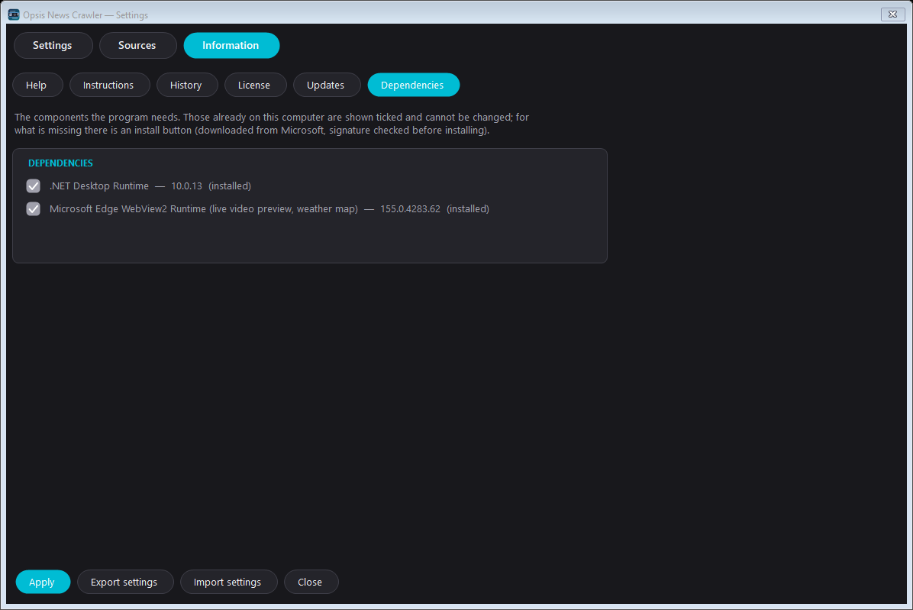<br/><sub>Dependencies</sub></td>
</tr>
</table>

The bar itself:

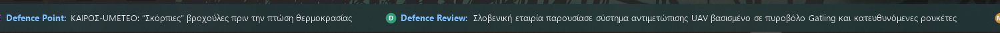<br/>
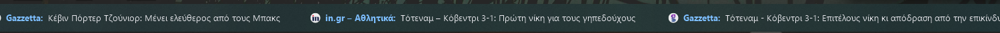<br/>
<br/>


All screenshots: [`docs/screenshots/en`](docs/screenshots/en) · [`docs/screenshots/el`](docs/screenshots/el).

### Installation

Download the latest `OpsisNewsCrawler-Setup.exe` from [Releases](../../releases) and run it (no administrator rights needed). The
wizard asks:

1. **How to install**: integrated plugin of Opsis, or a separate application.
2. **Default bar**: above the taskbar, or inside it.
3. **Dependencies**: .NET 10 Desktop Runtime and WebView2 Runtime. Components that are already there are shown ticked and cannot be
   changed; missing ones are downloaded from Microsoft and run only if the file carries a valid Microsoft signature.

Silent install: `OpsisNewsCrawler-Setup.exe /VERYSILENT /SUPPRESSMSGBOXES /NORESTART /MODE=separate|integrated /BAR=above|taskbar /DEPS=all|dotnet|webview2|none`
(`/DEPS` defaults to `none`: a silent install never downloads anything by itself). The SHA-256 of the installer is published next
to it (`OpsisNewsCrawler-Setup.exe.sha256`).

> The installers are not code-signed; Windows SmartScreen may warn.

### Building from source

```
dotnet build OpsisNewsCrawler.sln -c Release
dotnet test  OpsisNewsCrawler.sln -c Release
powershell -ExecutionPolicy Bypass -File tools\release.ps1     # publish + installer (Inno Setup 6) + SHA-256, with checks
```

Needs the .NET 10 SDK and Inno Setup 6. `tools\release.ps1` fails when the plugin packed into the installer has a different version
from the application.

### Repository layout

- `src/OpsisNewsCrawler.Core/` — models, settings, RSS, prices, weather, portfolio, languages (`Locales\*.json`)
- `src/OpsisNewsCrawler.Windows/` — all WinForms UI (bars, settings, portfolio, icon) and Win32
- `src/OpsisNewsCrawler.App/` — the stand-alone app (notification-area icon)
- `src/OpsisNewsCrawler.OpsisPlugin/` — the plugin DLL for Opsis · `src/OpsisNewsCrawler.Plugin.Abstractions/` — the contract
- `tests/OpsisNewsCrawler.Core.Tests/` — unit tests (xUnit) · `installer/` — shared installer parts · `tools/` — `release.ps1`
- `docs/` — release notes, data sources (`DATA-SOURCES.md`), task list (`TASKS.md`), screenshots

### Data sources and credits

News: the publishers' own RSS feeds (only the title, a short summary and the link are shown). Prices: Euronext, gold-api.com,
Frankfurter/ECB, FRED/EIA. Weather: [Open-Meteo.com](https://open-meteo.com) (CC BY 4.0). Map: © OpenStreetMap contributors. The
portfolio idea comes from [stonks-cli](https://github.com/igoropaniuk/stonks-cli) (MIT) and the RSI/SMA idea from
[greek-stocks-ai](https://github.com/karidasd/greek-stocks-ai); the code was written from scratch. Prices are not investment advice.
Details and terms: [`docs/DATA-SOURCES.md`](docs/DATA-SOURCES.md).

## Άδεια / License

MIT — δείτε το / see [`LICENSE`](LICENSE).
